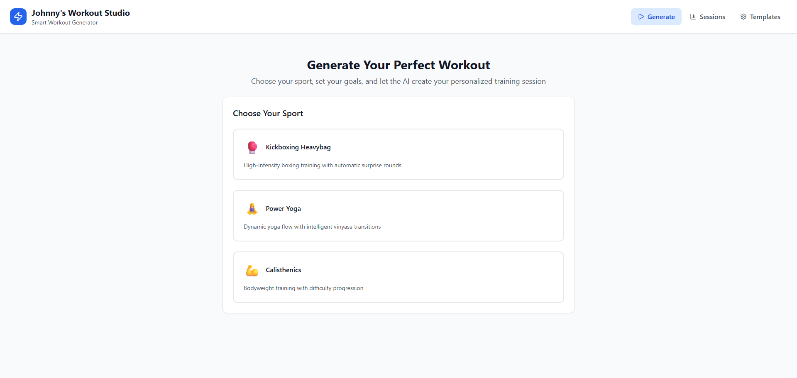

# Foxingfit Smart Workout Generator



**Django REST API for intelligent workout script generation with multi-language audio support.**

[](https://djangoproject.com/)
[](https://python.org/)
[](https://www.django-rest-framework.org/)
Built for a professional fitness coach to automate workout script creation across three sports: Kickboxing Heavybag, Power Yoga, and Calisthenics.

## Overview

This backend powers the Foxingfit platform — a smart workout generator that produces varied, timed training scripts by intelligently combining pre-written content blocks. It eliminates decision fatigue while maintaining sport-specific coaching methodology.

**What it does:**
- Generates 15–120 minute workout scripts with sport-specific intelligence
- Builds multi-language audio workouts (Dutch/English) via TTS audio merging
- Provides a content management system through Django Admin for coaches to maintain their own script library
- Tracks usage/freshness to ensure variety across sessions

## Features

### Workout Generation Engine
- **Sport Intelligence:** Auto surprise rounds (kickboxing), vinyasa transitions (yoga), difficulty progression with MAX challenge (calisthenics)
- **Template System:** Coach-defined workout structure with OR logic, repeatable sections, duration constraints
- **Time-Filling Algorithm:** 3-phase approach — initial pass, time-fill, final trim — hits target duration within tolerance
- **Freshness Algorithm:** Scores scripts by recency to avoid repetition (0.3–1.0 range)
- **Goal System:** `allround`, `strength`, `flexibility` with fallback logic

### Audio Workout Pipeline
- Upload per-script audio files (Dutch + English) via admin
- Auto-generate audio playlists from workout sessions
- Merge segments into a single MP3 with pauses, volume normalization, anti-clipping
- Motivational quote audio inserted between exercise blocks
- Stream/download individual segments or full merged file

### Content Management (Django Admin)
- Protected system categories that power sport-specific logic (cannot be deleted)
- Full CRUD for scripts, categories, quotes, and templates
- Audio upload with automatic metadata extraction (mutagen)
- Workout session history with usage tracking and notes

## Architecture

```
Frontend (React + Vite)          Backend (Django REST API)
─────────────────────────        ─────────────────────────
foxing-fit.vercel.app  ──────>  foxingfit.pythonanywhere.com/api/
                                     │
                                     ├── /generator/  — Workout generation + audio
                                     └── /scripts/    — Content CRUD
```

- **Frontend:** Separate React app deployed on Vercel (not in this repo)
- **Backend:** Django 5.2 + DRF on PythonAnywhere (this repo)
- **Database:** PostgreSQL
- **Static Files:** WhiteNoise
- **Audio Processing:** pydub + mutagen

## Quick Start

```bash
# Clone
git clone https://github.com/numanijaz119/Foxingfit-smart-workout-generator.git
cd Foxingfit-smart-workout-generator

# Virtual environment
python -m venv venv
source venv/bin/activate  # Windows: venv\Scripts\activate
pip install -r requirements.txt

# Database
cp .env.example .env  # edit with your DB credentials
python manage.py migrate
python manage.py createsuperuser

# System setup (creates categories + templates)
python manage.py setup

# Run
python manage.py runserver
```

**Access:** Admin → `http://localhost:8000/admin/` | API → `http://localhost:8000/api/`

## Environment Variables

Create a `.env` file:

```env
DJANGO_SECRET_KEY=your-secret-key
DJANGO_DEBUG=True
DB_NAME=your_db_name
DB_USER=your_db_user
DB_PASSWORD=your_db_password
DB_HOST=localhost
DB_PORT=5432
```

`MERGED_AUDIO_TTL_HOURS` (default `2`) controls how long merged MP3 files live before auto-cleanup.

## API Reference

### Workout Generation

| Endpoint | Method | Description |
|---|---|---|
| `/api/generator/generate/generate_workout/` | `POST` | Generate a workout |
| `/api/generator/generate/preview_template/` | `GET` | Preview template structure |
| `/api/generator/sessions/` | `GET` | List workout sessions |
| `/api/generator/sessions/{id}/` | `GET`, `DELETE` | Get/delete a session |
| `/api/generator/sessions/{id}/mark_used/` | `POST` | Mark session used/unused |
| `/api/generator/sessions/{id}/update_notes/` | `POST` | Update session notes |

### Audio

| Endpoint | Method | Description |
|---|---|---|
| `/api/generator/audio/generate_playlist/` | `POST` | Build audio playlist from session |
| `/api/generator/audio/merge_playlist/` | `POST` | Merge playlist into single MP3 |
| `/api/generator/audio/list_playlists/` | `GET` | List audio playlists |
| `/api/generator/audio/{id}/get_playlist/` | `GET` | Get playlist details |
| `/api/generator/audio/{id}/download_segment/` | `GET` | Download single audio segment |

### Content Management

| Endpoint | Method | Description |
|---|---|---|
| `/api/scripts/scripts/` | `GET`, `POST` | Workout scripts |
| `/api/scripts/categories/` | `GET`, `POST` | Script categories |
| `/api/scripts/quotes/` | `GET`, `POST` | Motivational quotes |
| `/api/scripts/templates/` | `GET`, `POST` | Workout templates |

### Example: Generate a Workout

```bash
curl -X POST http://localhost:8000/api/generator/generate/generate_workout/ \
  -H "Content-Type: application/json" \
  -d '{
    "training_type": "kickboxing",
    "goal": "strength",
    "target_duration": 60
  }'
```

Response:

```json
{
  "success": true,
  "workout": {
    "title": "Kickboxing - Strength - 2025-08-10 14:30",
    "total_duration": 58.5,
    "time_status": "Perfect (58.5min within ±5min target)",
    "sport_specific_additions": {
      "surprise_rounds_added": 2
    },
    "compiled_script": "**Onthoud, [elke stoot maakt je sterker]**\n\n## Warm-up..."
  }
}
```

## Sport Intelligence

| Sport | Auto-Features |
|---|---|
| Kickboxing Heavybag | Surprise rounds auto-inserted after core sections |
| Power Yoga | Vinyasa transitions (standing-to-standing, standing-to-sitting) between pose changes |
| Calisthenics | Difficulty progression: warmup → basic → advanced → MAX challenge at end |

All automation is controlled by the coach through the **Workout Templates** admin — enable/disable checkboxes per template step.

## Management Commands

| Command | Purpose |
|---|---|
| `python manage.py setup` | Create system categories + default templates |
| `python manage.py setup --categories-only` | Categories only |
| `python manage.py setup --templates-only` | Templates only |
| `python manage.py setup --dry-run` | Preview without saving |
| `python manage.py import_scripts --folder-path DATABASE_CONTENT` | Import workout scripts from structured folders |
| `python manage.py import_quotes --folder-path DATABASE_CONTENT` | Import motivational quotes from DOCX files |
| `python manage.py import_audio_scripts --import` | Import MP3 audio for workout scripts |
| `python manage.py upload_quote_audio --path /path/to/audio` | Upload quote audio files |
| `python manage.py cleanup_merged_audio` | Delete expired/orphaned merged MP3 files |

## Project Structure

```
Foxingfit-smart-workout-generator/
├── backend/                 # Django project config
│   ├── settings.py          # DB, CORS, DRF, static/media settings
│   ├── urls.py              # Root URL routing
│   └── wsgi.py              # WSGI entry (gunicorn)
├── scripts/                 # Content management app
│   ├── models.py            # ScriptCategory, WorkoutScript, MotivationalQuote, WorkoutTemplate
│   ├── views.py             # REST API ViewSets
│   └── management/commands/ # Import & setup commands
├── generator/               # Workout generation engine
│   ├── generator.py         # Core intelligent generation logic (~1300 lines)
│   ├── models.py            # WorkoutSession, AudioPlaylist, AudioSegment
│   ├── views.py             # Generation + audio API endpoints
│   ├── audio_merge_engine.py    # pydub-based MP3 merging
│   ├── audio_playlist_builder.py # Playlist construction
│   ├── audio_validator.py       # mutagen-based validation
│   ├── branding.py              # Dutch opening/closing texts
│   └── quote_processor.py       # Motivational quote insertion
├── media/                   # Uploaded/generated audio files
├── docs/                    # Documentation assets
├── requirements.txt         # Python dependencies
├── manage.py               # Django CLI entry
└── .gitignore
```

## Tech Stack

| Component | Technology |
|---|---|
| Backend | Django 5.2, Django REST Framework 3.16 |
| Database | PostgreSQL |
| Audio Processing | pydub 0.25, mutagen 1.47 |
| Static Files | WhiteNoise 6.9 |
| CORS | django-cors-headers 4.7 |
| WSGI | Gunicorn 23.0 |
| Env Config | python-dotenv 1.1 |
| Document Import | python-docx 1.2 |

## Deployment

- **API:** PythonAnywhere (`foxingfit.pythonanywhere.com`)
- **Frontend:** Vercel (`foxing-fit.vercel.app`)
- **Audio cleanup:** `MERGED_AUDIO_TTL_HOURS=2` auto-deletes old merged files (no cron needed)

## Client Context

Built for a fitness instructor ("Foxing Fit") who records audio workout sessions. The system generates the scripts, the coach records them via TTS (Murf.ai), and the audio pipeline merges everything into a single downloadable MP3 with motivational quotes embedded between exercises. Primarily Dutch-language content with English support added later.

